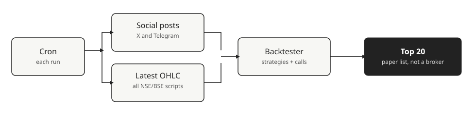

<p align="center">
  <a href="https://github.com/garv08/social-alpha/actions/workflows/ci.yml"></a>
  
  
  
  
</p>

<h1 align="center">social-alpha</h1>

<p align="center">
  <b>Backtest what people post about Indian stocks. Paper-trade only what still holds up.</b><br>
  X and Telegram calls, daily NSE/BSE bars, 95 strategies, a MADE score, and a local chart. No broker.
</p>

social-alpha joins two local projects:

- **social-archiver** — local scraper for X handles, X lists and Telegram channels (posts + media). It is not a published GitHub repository.
- **[TOP — Trade Observability Platform](https://github.com/garv08/Trade-Observability-Platform)** — included in this repo. The `top` package, its docs, and `data/nse.duckdb` are the market desk. The upstream repository is the source that copy came from.

and adds a **MADE** model (Karpathy's [pytorch-made](https://github.com/karpathy/pytorch-made) masked autoencoder, ported to pure Python) that learns what the technical picture looks like when people post a bullish call.

This repository is a superset of TOP. `top/` is the desk. `data/nse.duckdb` is this repo's own store, copied from TOP on 14 Nov 2026: 8,097 symbols, 7,375,961 daily bars from 2021-11-01 through 2026-11-13, delivery, breadth, and a leaderboard row for each of the 95 strategies. Indicators are not a second table. The 153 studies are computed from those bars by `top/indicators.py`. The database stays on disk and out of git because it is 515 MB, above GitHub's 100 MB file limit.

<p align="center">
  
</p>

Each cron run pulls new X and Telegram posts and joins them to the DuckDB OHLC store. That join becomes a 95-bit strategy state for the day. **MADE**, the masked autoencoder, is trained on those bits from bullish-call days against the same bits on random stock-days. A new day is scored as log p(call) minus log p(background). That score is one input to a **conviction** blend, not an order. The backtester is a separate check: it scores the calls on later closes versus the Nifty, and it does not set the rank. The monitor charts the pick from our own bars. Nothing in the picture sends an order.

<p align="center">

| Desk | Store | Rank | Gate |
|---|---|---|---|
| 95 strategies, 153 studies | 8,097 symbols, daily bars | MADE plus a 0–100 conviction score | Sanitized BUY, paper books only |

</p>

> [!IMPORTANT]
> Research tool, not advice. Social posts are noisy, archives are incomplete, and backtests describe the past. The paper books trade imaginary money. The sanity table is a synthetic-bar check, not a market return.

## Framework

The picture above is the whole loop: cron, posts, daily OHLC, strategy bits, MADE, conviction, backtest, top 20. The desk inside the backtester still follows the [TradingAgents](https://github.com/TauricResearch/TradingAgents) roles (Tauric Research, arXiv 2412.20138), as rules rather than language-model calls. It does not install that project. The portfolio manager can approve a paper name. It cannot reach a broker.

| TradingAgents role | This repo |
|---|---|
| Technical analyst | TOP's 95 strategies on DuckDB bars the cron has already written, dated on or before D |
| Sentiment analyst | X and Telegram calls published by the end of D |
| News analyst | Themes extracted from those posts. There is no separate news wire |
| Fundamentals analyst | Abstains. TOP has no point-in-time filings |
| Bull / bear researchers | The two sides of `decide()` |
| Trader | A paper proposal. Not an order router |
| Risk team | Aggressive, neutral, and conservative. Only the conservative vote can open |
| Portfolio manager | BUY, OVERWEIGHT, HOLD, UNDERWEIGHT, SELL. Only BUY can open a paper book |

```
INGEST  →  PROCESS AS OF DATE D  →  RATE  →  SCORE ON LATER CLOSES  →  PAPER
```

| Stage | Command | What it may see |
|---|---|---|
| Ingest | `ingest`, `fetch` | X handles, X lists, and Telegram channels already downloaded by social-archiver. Each post keeps its timestamp. |
| Process | `extract`, `evaluate`, `desk` | Posts published by the end of the as-of day (IST), TOP bars dated on or before that day, and themes from those posts. No filings. Fundamentals abstain. |
| Backtest | `backtest` | For each bullish call, the desk is rebuilt from creator scores whose 20-session window had already closed. The rating is then scored on the 5/20/60-session excess versus the Nifty 50. |
| Paper | `paper` | Two ₹10,000 books. An entry needs a sanitized desk BUY. Fills are the next open. |

```bash
.venv/bin/python -m social_alpha backtest
.venv/bin/python -m social_alpha backtest --start 2024-01-01 --end 2025-12-31
.venv/bin/python -m social_alpha validate-desk
```

`backtest` rewrites the decision grid. It does not place an order. A BUY that looks good on that grid is still only a paper permission. The technical veto is not applied backwards: confirming it uses later windows, so the historical rating records the opposition and does not pretend the veto was already known.

## Conviction score

The rank on the diagram is not MADE alone. `conviction.py` blends four lenses into 0–100, using the published weights from [renee-jia/trading-bot](https://github.com/renee-jia/trading-bot) and our own inputs. Their private scorer is not in that repo and is not used. Their US results are not ours. There is no Alpaca route.

| Lens | Weight | Here |
|---|---:|---|
| Technical | 35% | Bullish minus bearish strategy bits, as a stance |
| Trend | 30% | Excess versus the Nifty, when the row has it |
| Sentiment | 15% | Social stance, when the row has it |
| MADE | 20% | Rank of log p(call) − log p(background) inside the batch |

A missing lens is 50 and is named. Bear shrinks the score. Bull cannot lift it past 100. The top 20 are ladder-weighted, each name at most 25%. A bear book keeps 20% cash. Vol targeting is `min(1, 0.40 / annualized vol)` and never levers. The paper books already size a name as one of four slots. A high score still cannot open an order unless the sanitized desk says BUY.

## What it answers

| Question | Where |
|---|---|
| Which creators' stock calls actually beat the Nifty 50 afterwards? | Creators table (20-session excess return, shrunk for small samples) |
| Which setups (breakout, VCP, RSI…) and themes (FII buying, promoter buying, results…) work? | Setups / Themes tables |
| What were they *really* trading? | Strategy lift: which of TOP's 95 strategies are long at social calls far more often than on random stock-days; per-creator fingerprints |
| Did the call work better when TOP's best strategy for that stock agreed? | "x20 when TOP agreed / disagreed" columns |
| Which stocks look like the next social call today? | MADE scan (log p_calls − log p_background) |
| Would following them make money from here on? | Two paper books, ₹10,000 each, stepped every trading day |

## How it works

1. **Fetch** (optional) — runs social-archiver for each source in `config.toml` with a short trailing window. Archives are resumable and merge.
2. **Ingest** — reads every archive folder under `archive_roots`: X `tweets.json` (handles and lists; list posts are attributed to their real author), Telegram `posts.jsonl` (Telethon) or `messages.jsonl` (bridge). Runs that stopped early are read from `_state.json`.
3. **TOP data** — if TOP's store is behind the latest weekday, runs `top-sync --auto` (which goes through a running TOP server when there is one). Reads the store directly, or through TOP's HTTP API when the server holds the file.
4. **OCR** (optional) — `tesseract`, when installed, reads chart screenshots; the text is a low-confidence extra source.
5. **Extract** — matches TOP's ~8,000 symbols by `NSE:`/`BSE:` prefix, TradingView link, `$cashtag`, `#hashtag` (also `#muthootfinance`-style company hashtags), company name ("TBO Tek Ltd"), or bare ticker. Bare tickers, cashtags and one-word names are trusted only from creators who mostly post about Indian markets, or in posts with Indian-market words (₹, NSE, Nifty, FII, crore…). Then stance, entry (`buy above 112` → stop-entry), stop loss, targets, setups, themes and horizon. A post naming one stock with a direction or levels is a **call**; list posts are **mentions**. An OpenAI-compatible LLM can handle posts the rules cannot settle (off unless configured).
6. **Evaluate** — with no look-ahead:
   - posted before 09:15 IST → fill at that day's open; during market hours → that day's close; after 15:30 or on a holiday → next open;
   - `above`/`below` entries wait up to 5 sessions for the level;
   - stop and target on daily highs/lows (stop first when both fall in one bar; gaps fill at the open); 8% default stop, 20-session time exit;
   - returns 5/20/60 sessions after the fill, and the same minus the Nifty 50 (excess); bearish calls are scored as shorts.
   - TOP state at the last close before the post: which of the 95 strategies were long, and the stock's best strategy by CAGR ÷ |max drawdown| on history before that month.
7. **MADE** — two masked autoencoders over the 95-bit strategy-state vectors: one on bullish calls, one on random liquid stock-days. Retrained weekly; validation loss is reported against an independent-bits baseline so you can see whether it learned anything.
8. **Scan** — today's state of the ~400 most liquid stocks, ranked by the MADE score.
9. **Desk** — the same shape as a research firm ([TradingAgents](https://github.com/TauricResearch/TradingAgents)), without that project's language-model calls or US data vendors. Four rule reports (TOP technical state, social calls, post themes, and an explicit "no filings" fundamentals note) go to a bull/bear read and a risk vote. The portfolio manager rates BUY, OVERWEIGHT, HOLD, UNDERWEIGHT, or SELL. Only BUY can open a paper order. SELL is a note; the existing paper risk rule still places the exit. Nothing in this step calls a broker.
10. **Paper books** (₹10,000 each, whole shares, long only, orders fill at next open, 10 bps per side):
   - **copy** — bullish calls from creators with ≥ 8 closed 20-day calls and a positive shrunk score, counting only calls that had closed before the day (walk-forward). Uses the post's stop and target, otherwise 8% and 20 sessions.
   - **ours** — TOP strategies with social attention as the filter: stocks with bullish mentions in the last 10 days plus the top MADE scan names; for each, the TOP strategy with the best CAGR ÷ drawdown on prior data; buy when it has just turned long, sell when it turns flat or hits the stop.
11. **Improve** — the self-improving loop (see [docs/architecture.md](docs/architecture.md)). Failures in expectancy are turned into proposals. A proposal becomes a paper-book gate only when the same failure repeats on later, unseen calls. Live broker execution is refused.
12. **Report** — `output/report.html` and CSVs (creators, setups, themes, symbols, calls, scan, paper trades, sources).

## Install

Requires Python 3.11–3.13. The TOP desk is the vendored [`top`](top) package in this repo: DuckDB store, daily OHLC sync, indicators, the 95 strategies, and the request-based chart. `top-sync` fills `data/nse.duckdb`. That file is local state, not part of the git history, because it changes every session and is too large to ship.

```bash
git clone https://github.com/garv08/social-alpha.git && cd social-alpha
python3 -m venv .venv
.venv/bin/pip install -e .
cp config.example.toml config.toml                                # set paths, sources, capital
```

No NumPy or PyTorch: everything, including MADE, is plain Python, so it runs on the same old CPUs TOP supports.

## Use

```bash
.venv/bin/python -m social_alpha daily --force   # whole pipeline now
.venv/bin/python -m social_alpha install-cron    # every 30 min; acts once per weekday after 19:30 IST,
                                                 # waits for TOP's update, runs anyway on holidays after 23:30
```

Single steps: `ingest`, `fetch`, `ocr`, `extract [--redo]`, `evaluate`, `train [--rebuild-background]`, `scan`, `desk`, `validate-desk`, `backtest`, `paper`, `improve`, `report`, `monitor`, `chart`.

Two local pages, both bound to this machine:

| Command | Address | What you can check |
|---|---|---|
| `social-alpha chart` | [http://127.0.0.1:8000](http://127.0.0.1:8000) | The full TOP desk: every script, study, strategy, backtest, leaderboard, and chart |
| `social-alpha monitor` | [http://127.0.0.1:8765](http://127.0.0.1:8765) | The paper list and the bars behind the latest scan |

`chart` reads this repo's `data/nse.duckdb`. It does not download history unless you pass `--sync`. `monitor` is the thinner status page. Neither page can place an order.

`validate-desk` strips markup from stored ratings, cancels any open paper buy that does not have a sanitized desk BUY, and checks the technical veto on calls whose 20-day window closed after the cut date. A veto that does not repeat there is recorded and is not allowed to block a paper entry.

The feedback loop is [docs/architecture.md](docs/architecture.md). Notes on the StockMar list, including what was not OCR'd, are in [docs/stockmar-analysis.md](docs/stockmar-analysis.md).

`scripts/scrape_stockmar_missing.py` back-fills a year of posts for list members that have no archive yet (India-focused handles first).

## Configuration

See [config.example.toml](config.example.toml). Main keys: `archive_roots`, `sources` (what `daily` fetches), `authors` (restrict analysis), `paper_capital`, `paper_max_positions`, `copy_min_calls`, `cost_bps`, `max_hold_days`, `default_stop_pct`, `scan_universe`/`scan_limit`, `llm_url`/`llm_model` (key in the `SOCIAL_ALPHA_LLM_KEY` env var), MADE size and epochs.

## Limitations

- **Levels are mostly in images.** The Indian accounts analysed so far post charts and stock lists; very few posts carry entry/SL/target in text. Without OCR those become *mentions*, scored on 20-day excess return. Install `tesseract-ocr` to read chart headers and levels.
- **Daily bars only.** Intraday calls (Nifty/Bank Nifty option levels) cannot be evaluated properly.
- **Survivorship and coverage.** TOP lists today's scripts; archives cover what was scraped; deleted posts are missing; X search is rate-limited.
- **Small samples.** Scores are shrunk toward zero (n / (n + 10)) and t-stats are shown; treat creators with few calls as unknown.
- **A ₹10,000 book** cannot buy one share of many stocks; those orders are skipped and logged.

## Tests

```bash
python -m unittest discover -s tests -v
python -m social_alpha.sanity
```

CI runs that suite on Python 3.11, 3.12, and 3.13. The strategy sanity is 95 strategies times 11 checks: bounds, signal domain, determinism, no look-ahead, a finite backtest, positive ending equity, costs that cannot raise the return, and a volatility target that never levers. That is 1,045 checks. The latest table is [docs/ci/sanity-metrics.md](docs/ci/sanity-metrics.md). Each CI run also writes the same table to the job summary and uploads `sanity-metrics` as an artifact.

Those numbers are from generated bars. They are not NSE returns, and a pass is not an edge.

The other tests cover the MADE port, symbol matching, call extraction, post timing, and the paper-book simulator.

## Repositories referred to

These are the GitHub repositories this project actually uses or cites. social-archiver is local only, so it is not in the table.

| Repository | What we took | What we did not take |
|---|---|---|
| [garv08/social-alpha](https://github.com/garv08/social-alpha) | This paper-research desk | Live broker execution |
| [garv08/Trade-Observability-Platform](https://github.com/garv08/Trade-Observability-Platform) | The whole desk: `top/`, docs, and the current `data/nse.duckdb` (8,097 symbols, daily bars, 95 strategy leaderboard rows) | A second copy of that database in git. GitHub rejects files over 100 MB, and this store is 515 MB |
| [karpathy/pytorch-made](https://github.com/karpathy/pytorch-made) | MADE mask and ensemble-of-orderings, ported to pure Python | PyTorch, and any claim that the score is an edge |
| [TauricResearch/TradingAgents](https://github.com/TauricResearch/TradingAgents) | Analyst, researcher, trader, risk, and portfolio-manager roles, as rules | LangGraph, language-model calls, and US data vendors |
| [renee-jia/trading-bot](https://github.com/renee-jia/trading-bot) | Published 35/30/20/15 blend, letter grades, 25% name cap, bear cash reserve, vol target that never levers | Private `core/`, Alpaca paper or live execution, and their US results |
| [tradingview/lightweight-charts](https://github.com/tradingview/lightweight-charts) | Unmodified Apache-2.0 chart widget, with the required "Charting by TradingView" link | TradingView's private chart protocol. This project is not affiliated with TradingView |
| [neurotrader888](https://github.com/neurotrader888) | Some TOP strategy rules, reimplemented from published code onto daily NSE bars | That channel's results, and the original hourly crypto settings |

Credits and licenses are also in [NOTICE.md](NOTICE.md).

## License

MIT. MADE port credits in [NOTICE.md](NOTICE.md).
