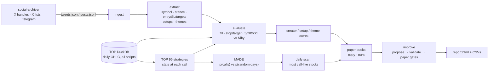

# social-alpha

**Backtest what people post about Indian stocks on X and Telegram, find which strategies they are really trading, and paper-trade the ideas that hold up — on your own machine.**

social-alpha joins two local projects:

- **[social-archiver](https://github.com/garv08)** — downloads X handles, X lists and Telegram channels (posts + media).
- **[TOP — Trade Observability Platform](https://github.com/garv08/Trade-Observability-Platform)** — daily OHLC for every NSE/BSE stock, ETF and index in DuckDB, plus 95 backtestable strategies.

and adds a **MADE** model (Karpathy's [pytorch-made](https://github.com/karpathy/pytorch-made) masked autoencoder, ported to pure Python) that learns what the technical picture looks like when people post a bullish call.



> [!IMPORTANT]
> Research tool, not advice. Social posts are noisy, archives are incomplete, and backtests describe the past. The paper books trade imaginary money.

## What it answers

| Question | Where |
|---|---|
| Which creators' stock calls actually beat the Nifty 50 afterwards? | Creators table (20-session excess return, shrunk for small samples) |
| Which setups (breakout, VCP, RSI…) and themes (FII buying, promoter buying, results…) work? | Setups / Themes tables |
| What were they *really* trading? | Strategy lift: which of TOP's 95 strategies are long at social calls far more often than on random stock-days; per-creator fingerprints |
| Did the call work better when TOP's best strategy for that stock agreed? | "x20 when TOP agreed / disagreed" columns |
| Which stocks look like the next social call today? | MADE scan (log p_calls − log p_background) |
| Would following them make money from here on? | Two paper books, ₹10,000 each, stepped every trading day |

## How it works

1. **Fetch** (optional) — runs social-archiver for each source in `config.toml` with a short trailing window. Archives are resumable and merge.
2. **Ingest** — reads every archive folder under `archive_roots`: X `tweets.json` (handles and lists; list posts are attributed to their real author), Telegram `posts.jsonl` (Telethon) or `messages.jsonl` (bridge). Runs that stopped early are read from `_state.json`.
3. **TOP data** — if TOP's store is behind the latest weekday, runs `top-sync --auto` (which goes through a running TOP server when there is one). Reads the store directly, or through TOP's HTTP API when the server holds the file.
4. **OCR** (optional) — `tesseract`, when installed, reads chart screenshots; the text is a low-confidence extra source.
5. **Extract** — matches TOP's ~8,000 symbols by `NSE:`/`BSE:` prefix, TradingView link, `$cashtag`, `#hashtag` (also `#muthootfinance`-style company hashtags), company name ("TBO Tek Ltd"), or bare ticker. Bare tickers, cashtags and one-word names are trusted only from creators who mostly post about Indian markets, or in posts with Indian-market words (₹, NSE, Nifty, FII, crore…). Then stance, entry (`buy above 112` → stop-entry), stop loss, targets, setups, themes and horizon. A post naming one stock with a direction or levels is a **call**; list posts are **mentions**. An OpenAI-compatible LLM can handle posts the rules cannot settle (off unless configured).
6. **Evaluate** — with no look-ahead:
   - posted before 09:15 IST → fill at that day's open; during market hours → that day's close; after 15:30 or on a holiday → next open;
   - `above`/`below` entries wait up to 5 sessions for the level;
   - stop and target on daily highs/lows (stop first when both fall in one bar; gaps fill at the open); 8% default stop, 20-session time exit;
   - returns 5/20/60 sessions after the fill, and the same minus the Nifty 50 (excess); bearish calls are scored as shorts.
   - TOP state at the last close before the post: which of the 95 strategies were long, and the stock's best strategy by CAGR ÷ |max drawdown| on history before that month.
7. **MADE** — two masked autoencoders over the 95-bit strategy-state vectors: one on bullish calls, one on random liquid stock-days. Retrained weekly; validation loss is reported against an independent-bits baseline so you can see whether it learned anything.
8. **Scan** — today's state of the ~400 most liquid stocks, ranked by the MADE score.
9. **Paper books** (₹10,000 each, whole shares, long only, orders fill at next open, 10 bps per side):
   - **copy** — bullish calls from creators with ≥ 8 closed 20-day calls and a positive shrunk score, counting only calls that had closed before the day (walk-forward). Uses the post's stop and target, otherwise 8% and 20 sessions.
   - **ours** — TOP strategies with social attention as the filter: stocks with bullish mentions in the last 10 days plus the top MADE scan names; for each, the TOP strategy with the best CAGR ÷ drawdown on prior data; buy when it has just turned long, sell when it turns flat or hits the stop.
10. **Improve** — the self-improving loop (see [docs/architecture.md](docs/architecture.md)). Failures in expectancy are turned into proposals. A proposal becomes a paper-book gate only when the same failure repeats on later, unseen calls. Live broker execution is refused.
11. **Report** — `output/report.html` and CSVs (creators, setups, themes, symbols, calls, scan, paper trades, sources).

## Install

Requires Python 3.11–3.13 and a TOP checkout with its data store (`data/nse.duckdb`; see TOP's README for the snapshot).

```bash
git clone https://github.com/garv08/social-alpha.git && cd social-alpha
python3 -m venv .venv
.venv/bin/pip install -e /path/to/Trade-Observability-Platform   # or let pip fetch TOP from GitHub
.venv/bin/pip install -e . --no-deps
cp config.example.toml config.toml                                # set paths, sources, capital
```

No NumPy or PyTorch: everything, including MADE, is plain Python, so it runs on the same old CPUs TOP supports.

## Use

```bash
.venv/bin/python -m social_alpha daily --force   # whole pipeline now
.venv/bin/python -m social_alpha install-cron    # every 30 min; acts once per weekday after 19:30 IST,
                                                 # waits for TOP's update, runs anyway on holidays after 23:30
```

Single steps: `ingest`, `fetch`, `ocr`, `extract [--redo]`, `evaluate`, `train [--rebuild-background]`, `scan`, `paper`, `improve`, `report`.

The feedback loop is [docs/architecture.md](docs/architecture.md). Notes on the StockMar list, including what was not OCR'd, are in [docs/stockmar-analysis.md](docs/stockmar-analysis.md).

`scripts/scrape_stockmar_missing.py` back-fills a year of posts for list members that have no archive yet (India-focused handles first).

## Configuration

See [config.example.toml](config.example.toml). Main keys: `archive_roots`, `sources` (what `daily` fetches), `authors` (restrict analysis), `paper_capital`, `paper_max_positions`, `copy_min_calls`, `cost_bps`, `max_hold_days`, `default_stop_pct`, `scan_universe`/`scan_limit`, `llm_url`/`llm_model` (key in the `SOCIAL_ALPHA_LLM_KEY` env var), MADE size and epochs.

## Limitations

- **Levels are mostly in images.** The Indian accounts analysed so far post charts and stock lists; very few posts carry entry/SL/target in text. Without OCR those become *mentions*, scored on 20-day excess return. Install `tesseract-ocr` to read chart headers and levels.
- **Daily bars only.** Intraday calls (Nifty/Bank Nifty option levels) cannot be evaluated properly.
- **Survivorship and coverage.** TOP lists today's scripts; archives cover what was scraped; deleted posts are missing; X search is rate-limited.
- **Small samples.** Scores are shrunk toward zero (n / (n + 10)) and t-stats are shown; treat creators with few calls as unknown.
- **A ₹10,000 book** cannot buy one share of many stocks; those orders are skipped and logged.

## Tests

```bash
python -m unittest discover -s tests -v
```

Covers the MADE port (autoregressive masks, exact gradients, normalised probabilities, learning correlations an independent model cannot), symbol matching, call extraction, post timing and the trade simulator.

## License

MIT. MADE port credits in [NOTICE.md](NOTICE.md).
